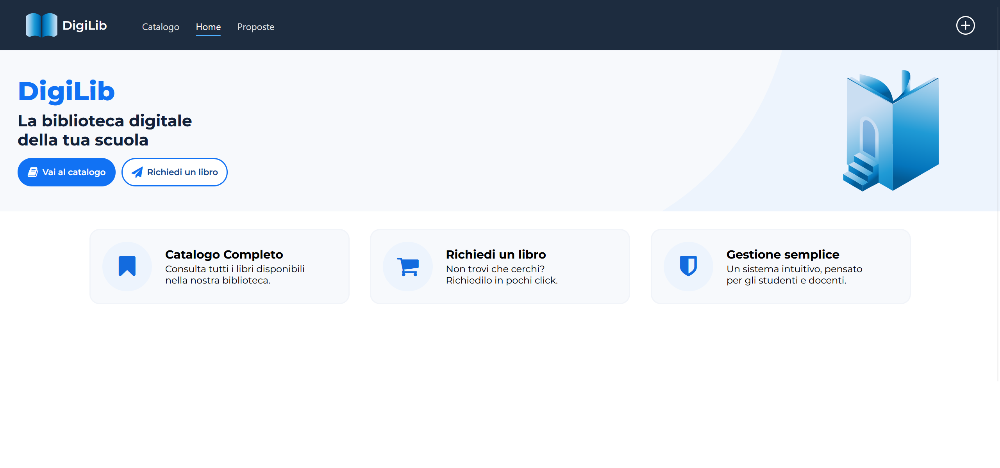
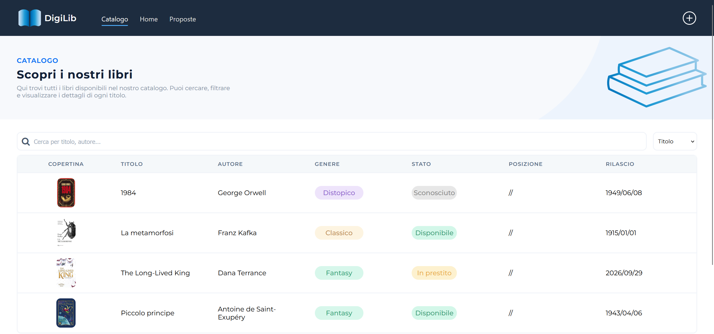
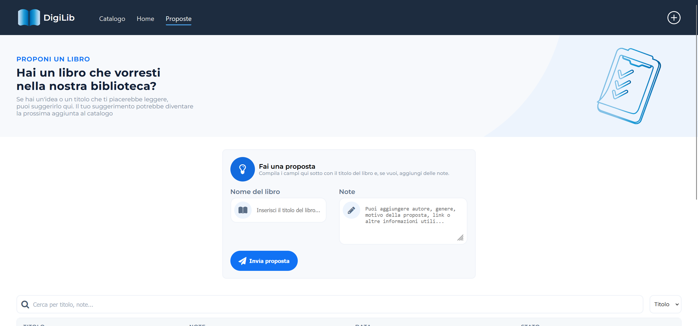
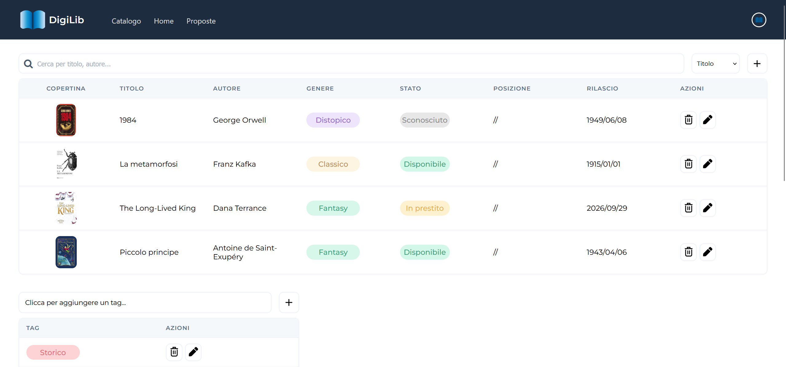

# 📘 DigiLib

DigiLib è un'applicazione web per gestire una biblioteca interna. Permette agli utenti di esplorare i libri e inviare suggerimenti, mentre agli amministratori possono gestire il catalogo.

## Funzionalità Principali

- **Home**  
  Mostra semplici banner testuali con gli obiettivi principali della biblioteca, come catalogo, prenotazioni e gestione.
- **Catalogo**  
  Elenca tutti i libri disponibili all'interno della biblioteca.
- **Suggerimenti**  
  Permette agli utenti di proporre nuovi libri indicando titolo e note.
- **Dashboard**  
  Consente agli amministratori di gestire i libri, creare tag da assegnare ai titoli e approvare o rifiutare i suggerimenti.

> Sviluppato come progetto scolastico.

## Anteprima

|||
|:---:|:---:|
| **Home Page** | **Catalogo** |

|||
|:---:|:---:|
| **Chat** | **Dashboard** |

